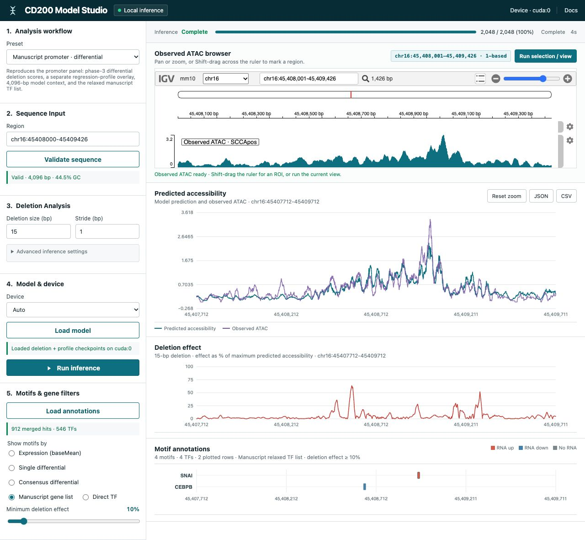

# CD200 Manuscript Bundle

Minimal, self-contained package for the CD200 ATAC deletion figures: train the
motif CNN checkpoints, regenerate the manuscript deletion scans, or explore the
same models in a local browser app (Model Studio).

## Get started with Codex or Claude Code

Download the source and reproduction-support archives from the [release page](https://github.com/fuxialexander/cd200_manuscript_bundle/releases/tag/v0.2.0-revision-20261107), follow its installation instructions, and open the resulting `modl_revision` folder in Codex or Claude Code. Then paste: **“Read `AGENTS.md` and `AGENT_WORKFLOW.md`; set up the documented Python 3.12 environment, run `cd200-modl doctor`, check my local data or supplied checkpoints, run a small test, and help me open Model Studio for interpretation. Ask me for missing inputs before starting.”** See the [agent workflow](https://github.com/fuxialexander/cd200_manuscript_bundle/blob/v0.2.0-revision-20261107/AGENT_WORKFLOW.md) and [Model Studio guide](MODEL_STUDIO.md) for detailed steps.

## Model Studio promoter analysis



**Promoter** — score deletions with the phase-3 **differential** head, and
overlay the accessibility profile from the **regression** checkpoint.

**Verified setup:** released checkpoints, local mm10/ATAC/RNA inputs, CUDA analysis server.

[Model Studio setup and workflow](MODEL_STUDIO.md)

## What this model does

The model is a **DNA → chromatin accessibility** predictor built around
**HOCOMOCO motif convolutions**.

Given a one-hot DNA window (manuscript inference uses **4,096 bp**), it:

1. Scans the sequence with fixed motif kernels (PWM-initialized, reverse-
  complement aligned; `artifacts/motifs_with_rc_aligned.pt`).
2. Passes motif activations through a dilated residual CNN.
3. Emits task-specific heads:


| Head                            | Meaning                                                           |
| ------------------------------- | ----------------------------------------------------------------- |
| **regression**                  | Base-resolution ATAC profile (accessibility along the window)     |
| **count**                       | Scalar summary of total signal in the window                      |
| **differential** (phase-3 only) | Scalar **SCCApos − SCCAneg** accessibility contrast (`Diff_scca`) |


**Manuscript figure roles**

- **Enhancers** — score 15 bp sliding deletions with the **regression** head
(bundled epoch=105 checkpoint).
- **Promoter** — score deletions with the phase-3 **differential** head, and
overlay the accessibility profile from the **regression** checkpoint.

Deletion analysis asks: if we remove 15 bp at each position, how much does the
predicted accessibility (or differential) change? Effects are distributed back
onto the deleted bases and plotted as

```text
plot effect (%) = 100 × |raw effect| / max(|baseline prediction|)
```

Motif tracks are then filtered with RNA-seq DEG / relaxed TF lists so only
biologically relevant TFs are highlighted.

```text
DNA (mm10 zarr)
    → motif CNN (+ optional TN5 bias model)
        → regression / count [/ differential]
            → 15 bp real-deletion scan
                → motif scan + DEG/TF filter
                    → manuscript plots or Model Studio UI
```

---


## Data: what is processed and how


### Bundled stores


| Asset             | Path                                                   | Role                                            |
| ----------------- | ------------------------------------------------------ | ----------------------------------------------- |
| Genome sequence   | `data/zarr/mm10.zarr`                                  | mm10 one-hot DNA                                |
| ATAC signal       | `data/zarr/cd200_scc_dense_new.zarr`                   | Dense bp tracks for SCC / SC1 / SC1C pos & neg  |
| Motif kernels     | `artifacts/motifs_with_rc_aligned.pt` (+ `.txt` names) | CNN first layer                                 |
| TN5 bias motifs   | `artifacts/bias.meme`                                  | Phase-3 bias model                              |
| HOCOMOCO metadata | `artifacts/data/hocomoco/`                             | PWM / TF annotation fallback                    |
| Regression peaks  | `training/data/total.bed`                              | ~51k training windows for the profile model     |
| Phase-3 peaks     | `training/data/scc_all_peaks.deduplicated.bed`         | ~184k peaks with `Diff_scca`, `peak_type`, etc. |
| RNA DEG tables    | `analysis/rnaseq_deg_analysis/`                        | Motif gene filters                              |


ATAC cell-type keys used by the manuscript scripts:

- `SCCApos.cd200_scc` — observed overlay and regression training target
- `SCCAneg.cd200_scc` — phase-3 main-model target; differential is pos vs neg


### Training-time processing

For each BED interval the datamodule:

1. Takes the interval center and builds a **±2,048 bp** window → **4,096 bp**
  of DNA from `mm10.zarr`.
2. Pulls the matching ATAC slice from the dense ATAC zarr (library-size
  metadata is stored on the store).
3. Optionally applies augmentation (random shift / reverse complement) during
  training.
4. Splits by chromosome for the regression launcher (default holdouts:
  **val = chr14**, **test = chr10**).
5. Uses **curriculum sampling** by signal strength (`MaxValue` for regression;
  `logSumValue_scca_neg` / `Diff_scca` in later phase-3 phases).

Phase-3 BED rows also carry:

- `peak_type` — `background` / `for_count` / `for_profile` (which phase sees them)
- `Diff_scca` — training target for the differential head


### Inference-time processing

Manuscript deletion scripts (`analysis/scripts/run_cd200_*.sh`):

1. Load DNA/ATAC for the region with **4,096 bp** context (`--extend-bp 4096`).
2. Predict the unperturbed baseline.
3. For every start position (stride 1), apply a **real 15 bp deletion**
  (sequence is stitched, not zero-masked).
4. Re-predict; convert window-level change into per-base effects
  (`--distribute-effects`).
5. Run FIMO-style motif scoring with the model kernels +
  `analysis/fimo_mappings_cache.pkl`.
6. Filter motifs (DEG consensus or relaxed TF gene list) and plot a central
  **2 kb** window (`CENTER_WINDOW_BP=2000`).

Canonical figure inputs:

- Enhancers → `analysis/results/cd200_analysis_new/`
- Promoter → `analysis/results/cd200_promoter_analysis/`

---


## Layout


| Path                                   | Contents                                           |
| -------------------------------------- | -------------------------------------------------- |
| `analysis/scripts/`                    | Four manuscript inference entrypoints              |
| `analysis/checkpoints/`                | Bundled regression + phase-3 weights               |
| `analysis/results/`                    | Canonical CSVs / plots for figure regeneration     |
| `training/`                            | Training launchers + BED inputs                    |
| `src/`                                 | Shared training and mutation-analysis code         |
| `model_studio/`                        | Local website (adapters, UI, IGV)                  |
| `artifacts/`, `configs/`, `data/zarr/` | Motifs, configs, sequence/ATAC stores              |
| `scripts/`                             | `bundle_env.sh`, validation, Model Studio launcher |


---


## Environment

```bash
source scripts/bundle_env.sh
```

Bootstrap order for the Python env:

1. `UV_PROJECT_ENVIRONMENT` if already set
2. `CD200_UV_ENVIRONMENT` if set
3. local `.venv`
4. sibling `../motif_chip_model/.venv` if present
5. otherwise create `.venv` with `uv sync`

Caesarion (zarr IO) is expected at `../Caesarion/src`, or set `CAESAR_SRC`.

Smoke test (no full GPU deletion scan):

```bash
source scripts/bundle_env.sh
"${PYTHON_CMD[@]}" scripts/validate_bundle.py
```

---


## Training

Two checkpoint families are used in the manuscript. Both default to the bundled
zarr stores and motif artifacts.

### 1. Regression / profile model (enhancers + profile overlay)

Produces checkpoints like the shipped

`analysis/checkpoints/shapescale_loss_scca_pos_with_count_head_fixed_motif_curriculum_from_scratch-epoch=105-val_loss=6.76.ckpt`

```bash
source scripts/bundle_env.sh
./training/scripts/train_regression_checkpoint.sh
```

Defaults (override with env vars of the same name):


| Setting             | Default                               |
| ------------------- | ------------------------------------- |
| ATAC track          | `SCCApos.cd200_scc`                   |
| Peaks               | `training/data/total.bed`             |
| Motifs              | `artifacts/motifs_with_rc_aligned.pt` |
| Split               | chromosome; val `chr14`, test `chr10` |
| Curriculum          | 5 MaxValue groups, equal sampling     |
| Batch / epochs / lr | 32 / 200 / 1e-3                       |
| Max regions         | 100000                                |


Checkpoints are written under the Lightning / W&B run directory for
`RUN_NAME` (default matches the shipped run stem). Copy the chosen `.ckpt` into
`analysis/checkpoints/` (or point `CHECKPOINT=` at it) for analysis / Model Studio.

### 2. Phase-3 differential model (promoter deletion scores)

Produces checkpoints like the shipped

`analysis/checkpoints/ATAC-Sequential-20250919-022148_phase3_final_model.ckpt`

```bash
source scripts/bundle_env.sh
./training/scripts/train_phase3_checkpoint.sh
```

This runs sequential phased learning (`configs/train_atac_phased.yaml`):


| Phase | Goal                                          | Launcher default epochs                       |
| ----- | --------------------------------------------- | --------------------------------------------- |
| 1     | TN5 **bias** model on background peaks        | `PHASE1_EPOCHS=0` (skipped unless you set it) |
| 2     | Main motif CNN on `for_count` / `for_profile` | `PHASE2_EPOCHS=50`                            |
| 3     | Train **differential** head on `              | Diff_scca                                     |


Other defaults: `CELLTYPE_IDS=SCCAneg.cd200_scc`, peaks
`training/data/scc_all_peaks.deduplicated.bed`, TN5 motifs `artifacts/bias.meme`,
batch 32.

Resume mid-pipeline with `PHASE1_CHECKPOINT` / `PHASE2_CHECKPOINT` /
`PHASE3_CHECKPOINT`. W&B logging is enabled in the training code; configure
credentials if you want remote runs.

**Note:** YAML epoch lists and the shell overrides can disagree. For a from-
scratch recipe matching this launcher, trust the **shell env defaults** above,
not the unused `phase_epochs` block alone.

### After training

1. Point manuscript scripts at the new files:
  `CHECKPOINT=... REGRESSION_CHECKPOINT=... ./analysis/scripts/...`
2. Or load them in Model Studio (Custom checkpoint, or replace the files under
  `analysis/checkpoints/` used by the manuscript preset).
3. Optional parity check against saved promoter curves:

```bash
"${PYTHON_CMD[@]}" tests/validate_manuscript_runtime.py \
  --bundle "$PWD" --device auto --batch-size 32
```

---


## Regenerating manuscript analyses (CLI)

```bash
source scripts/bundle_env.sh

# Three regions; enhancer figures use regression-head deletion scores
./analysis/scripts/run_cd200_mutation.sh

# Promoter: phase-3 differential deletions + regression profile overlay
./analysis/scripts/run_cd200_promoter_mutation.sh

# Promoter scored only with the regression checkpoint
./analysis/scripts/run_cd200_promoter_regression_mutation.sh
./analysis/scripts/run_cd200_promoter_regression_deg_mutation.sh
```

Shared defaults: CUDA device, 4,096 bp context, 15 bp real deletions, stride 1,
distribute effects, center crop 2 kb. Override with env vars documented in each
script (`CHECKPOINT`, `ATAC_ZARR_PATH`, `OUTPUT_DIR`, …).

---


## Using the website (Model Studio)

Model Studio is a **local-only** browser UI over the same models and deletion
math. Weights and DNA never leave the machine.

### Start

```bash
source scripts/bundle_env.sh
./scripts/run_model_studio.sh
# equivalent: "${PYTHON_CMD[@]}" -m model_studio.server
```

Open [http://127.0.0.1:8787](http://127.0.0.1:8787). The server binds to
localhost unless you pass `--host`.

### Recommended first run

1. Leave the preset on **Manuscript promoter · differential**.
2. Wait for the IGV track (local mm10 + `SCCApos` ATAC from the bundled zarr).
3. Shift-drag a region on the ruler (≤ 2 kb) or use the current viewport, then
  **Run selection / view**.
4. Inspect predicted accessibility (regression checkpoint), deletion-effect
  track (phase-3 differential), and motif rows (relaxed TF gene list).
5. Download JSON / CSV if you need the numerical tracks.

Device menu: **Auto** prefers CUDA, then Apple MPS, then CPU.

### Presets


| Preset                             | Deletion scores            | Profile overlay                  |
| ---------------------------------- | -------------------------- | -------------------------------- |
| Manuscript promoter · differential | Phase-3 **differential**   | Bundled epoch=105 **regression** |
| Promoter · regression model        | Same regression checkpoint | —                                |
| Custom checkpoint                  | Whatever you load          | Optional second checkpoint       |


Manuscript geometry (also documented in `MODEL_STUDIO.md`):

- Model context `chr16:45406665-45410761` (4,096 bp)
- Scoring core `chr16:45408000-45409426`
- Display window central 2 kb
- Deletion size 15, stride 1, real deletion, batch 32 (display-scoped scan by default)


### What the UI is *not*

- It does not train models (use `training/scripts/`).
- It does not replace the four CLI manuscript entrypoints for batch figure
dumps, though the promoter preset is built for figure parity.
- Only load checkpoints you trust; PyTorch unpickling can run code. Uploads are
copied under `model_studio/uploads/`.

Deeper adapter contract, annotation filter modes, IGV coordinate notes, and
verification commands: `[MODEL_STUDIO.md](MODEL_STUDIO.md)`.

---


## Checkpoints included


| File                                                      | Role                                                   |
| --------------------------------------------------------- | ------------------------------------------------------ |
| `...from_scratch-epoch=105-val_loss=6.76.ckpt`            | Regression head: enhancer deletions + promoter profile |
| `ATAC-Sequential-20250919-022148_phase3_final_model.ckpt` | Differential head: promoter deletions                  |


File inventory: `MANIFEST.tsv`.